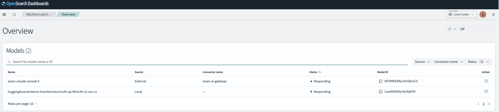
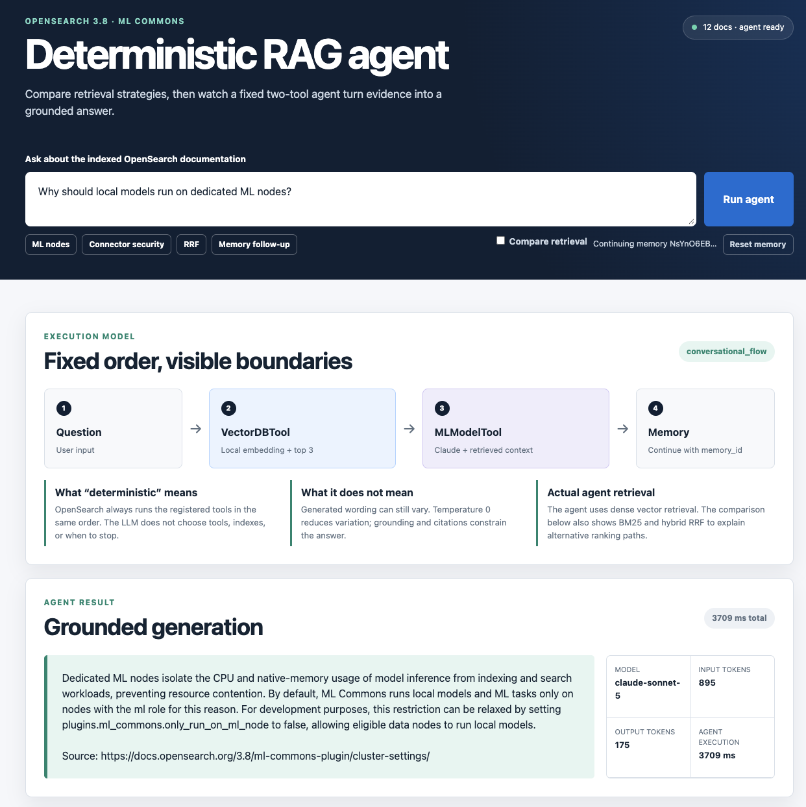
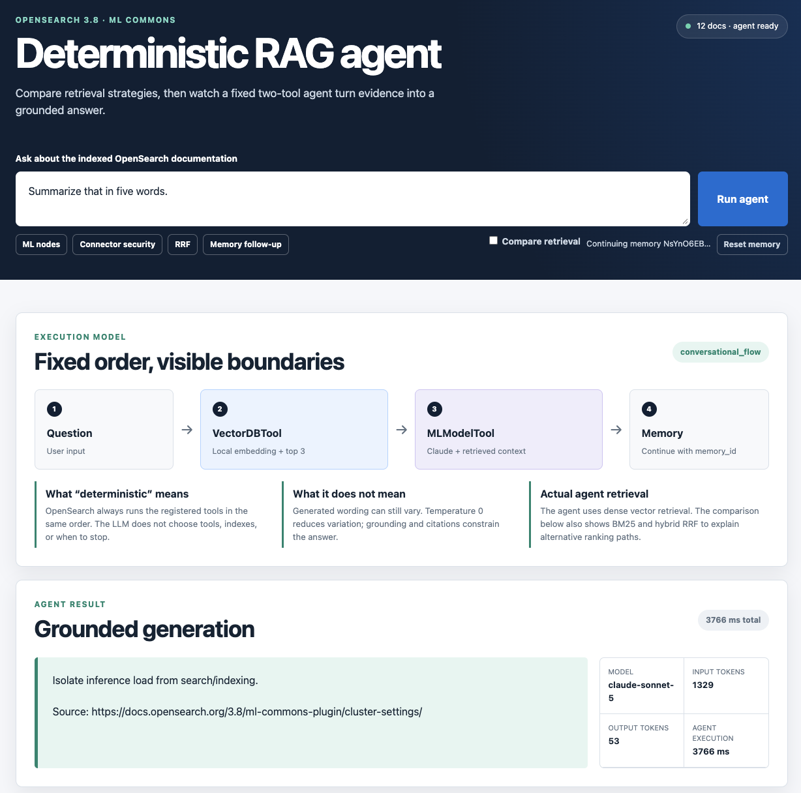

# Vienna OpenSearch user group demo

This project targets OpenSearch 3.8 on Aiven.

## Installation

Prerequisites:

- Python 3.10 or newer (the demo scripts use only the standard library)
- Access to an OpenSearch 3.8 service

From the project directory, create the local configuration:

```bash
cp .env.example .env
```

Add your OpenSearch and LLM credentials to `.env`, then verify the demo
configuration with:

```bash
python3 scripts/local_model.py selected
```

## Local embedding model

Copy `.env.example` to `.env`, add the Aiven service credentials, and select a
model using its full OpenSearch model-repository name:

```dotenv
LOCAL_MODEL_NAME=huggingface/sentence-transformers/multi-qa-MiniLM-L6-cos-v1
```

The model catalog supplies the corresponding version, format, function, and
vector dimension, so they do not need to be duplicated in `.env`.

```bash
# Show supported dense embedding models
python3 scripts/local_model.py catalog

# Show the selected model and derived metadata
python3 scripts/local_model.py selected

# Show models currently registered in the cluster
python3 scripts/local_model.py cluster

# Register the selected model without deploying it
python3 scripts/local_model.py register

# Register if necessary, then deploy it to an ML node
python3 scripts/local_model.py provision

# Run inference and verify the returned vector dimension
python3 scripts/local_model.py test
python3 scripts/local_model.py test --text "How does hybrid search work?"
```

`provision` changes cluster state and can take several minutes while the model
artifact is downloaded and loaded into native memory.

## Aiven AI Gateway LLM

The connector uses Aiven AI Gateway's OpenAI-compatible API with Claude Sonnet
5. The gateway model catalog exposes the model as `claude-sonnet-5` without an
`openai/` prefix:

```dotenv
LLM_BASE_URL=https://ai.aiven.io/v1
LLM_MODEL_NAME=claude-sonnet-5
LLM_API_KEY=replace-with-the-short-lived-gateway-key
```

The gateway key is sent once when the connector is created and is encrypted in
the ML Commons connector index. Prediction requests contain only the prompt and
model parameters.

Before provisioning, add the endpoint to the Aiven service's **Advanced
configuration**. Generate the exact value with:

```bash
python3 scripts/remote_llm.py allowlist
```

Set the returned
`opensearch.ml_commons_trusted_connector_endpoints_regex` array in Aiven.
Preserve any existing patterns because updating this setting replaces the
whole allowlist.

Then verify each boundary separately:

```bash
# Call the OpenAI-compatible endpoint directly
python3 scripts/remote_llm.py endpoint-test

# Create the encrypted connector, register the remote model, and deploy it
python3 scripts/remote_llm.py provision

# Call the LLM through OpenSearch ML Commons
python3 scripts/remote_llm.py test
python3 scripts/remote_llm.py test --prompt "Explain RRF in one sentence."
```

OpenSearch Dashboards shows both models responding: the local
`multi-qa-MiniLM-L6-cos-v1` embedding model and the external
`aiven-claude-sonnet-5` model connected through Aiven AI Gateway.



## Deterministic RAG agent

Build the small documentation knowledge base using the local embedding model:

```bash
python3 scripts/knowledge_base.py rebuild
python3 scripts/knowledge_base.py search \
  --query "Why should local models run on dedicated ML nodes?"
```

Register a `conversational_flow` agent whose fixed sequence is
`VectorDBTool -> MLModelTool`, then run an initial and follow-up question using
the same conversation memory:

```bash
python3 scripts/deterministic_agent.py provision
python3 scripts/deterministic_agent.py demo

python3 scripts/deterministic_agent.py ask \
  --question "How are connector credentials protected?"
```

The demo returns the answer, source URL, memory ID, model name, and token usage.

### Demo UI

The localhost-only UI calls the same registered agent while also comparing
BM25, dense vector, and hybrid RRF retrieval for the submitted question:

```bash
python3 scripts/demo_ui.py
```

Open http://127.0.0.1:8080. The server reads credentials from `.env`; no
OpenSearch or gateway credentials are sent to browser JavaScript. Keep using
the existing CLI commands when you want to demonstrate the API-oriented path.

The first question retrieves indexed documentation and produces a grounded
answer with its source, model, token usage, and execution time:



The follow-up reuses the same OpenSearch conversation memory, allowing the
agent to understand what “that” refers to and summarize the previous answer:



The **Out of domain** shortcut asks, “What is the weather in Vienna now?” Since
the document index contains no current weather data, the grounded agent says
that it does not know instead of inventing an answer:


## TLS

The Aiven endpoint currently presents a certificate trusted by the operating
system's standard CA store, so no custom `OPENSEARCH_CA_CERT` is required.
TLS certificate and hostname verification remain enabled.
